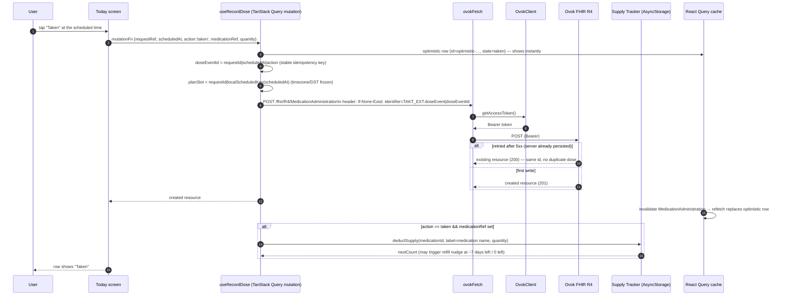
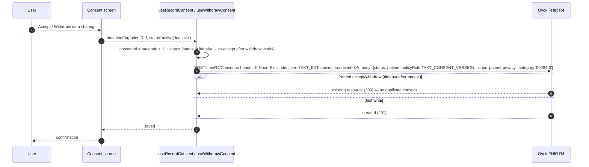

# Takt — End-to-end Architecture

Single source of truth for how Takt works end to end: what the app does, what the Ovok server stores, what stays local-only, and where the separate Node server (`@takt/server`) fits in.

> **Status:** accurate for `@ovok/core@0.4.42`, `@medplum/*@4.3.6`, Expo SDK 57 / React Native 0.86.3. See `docs/EDGE_CASES.md` for the open edge-case ledger.

---

## 1. System context

```mermaid
flowchart TD
    subgraph DEV [User's device — React Native / Expo SDK 57]
        direction TB
        UI[App UI — expo-router routes + Zustand/TanStack Query]
        LIB[src/lib — OvokClient, ovokFetch, FhirRepository, schedule, supply-tracker]
        STORE[(AsyncStorage — ExpoClientStorage, supply, locale, consent flag)]
        NOTIF[expo-notifications — dose & refill reminders]
        UI --- LIB
        LIB --- STORE
        LIB --- NOTIF
    end

    subgraph OVOK [Ovok SaaS platform — tenant `EXPO_PUBLIC_OVOK_TENANT_CODE`]
        direction TB
        AUTH[Auth routes — /auth/login, /auth/register, /auth/reset-password, /auth/sessions]
        FHIR[FHIR R4 server — /fhir/R4/{Patient, Medication, MedicationRequest, MedicationAdministration, Consent, RelatedPerson}]
        CAP[Capability statement — advertises public routes]
    end

    subgraph SERVER[@takt/server — Node ESM bots, runs on the tenant]
        direction TB
        BOTS[Bots — family-share-today, family-share-unconfirmed, family-share-scan, backfill-medication-scope, erasure]
        PUSH[expo-push — push notification delivery]
    end

    UI ==>|REST + Bearer token| AUTH
    LIB ==>|FHIR R4 /fhir/R4/…| FHIR
    BOTS ==>|FHIR R4| FHIR
    BOTS ==>|Push API| PUSH
    PUSH -.->|device token| UI
```

**Where each piece runs**

| Layer | Runs on | Responsibility |
|---|---|---|
| `app/` + `src/` | User's phone (RN/Expo) | UI, scheduling engine, supply tracking, auth UI, optimistic updates |
| `OvokClient` / `ovokFetch` | User's phone | Auth (PKCE + MFA), FHIR requests, token refresh, `Retry-After` |
| Ovok SaaS | Ovok cloud | Identity, FHIR R4 persistence, AccessPolicy enforcement, rate limits |
| `@takt/server` | Wherever the operator runs it (Node) | Family-share bots, medication-scope backfill, GDPR erasure, push delivery |

---

## 2. Container diagram — app side

```mermaid
flowchart TD
    subgraph ROUTES [expo-router routes]
        SIGN[auth/sign-in, auth/register, auth/reset-password, auth/reset-complete]
        TAB[/(tabs)/today — timeline + reminders]
        HIST[/(tabs)/history — adherence history]
        WEEK[/(tabs)/week — calendar heatmap]
        CONSENT[consent — patient privacy + family share]
        CARE[/(tabs)/care — contact, appointment]
        SET[settings — refills, reminders, privacy, release hub]
    end

    subgraph LAYERS [src/lib]
        CLIENT[ovok-client.ts — singleton OvokClient]
        FETCH[ovok-fetch.ts — Bearer + refresh + Retry-After]
        REPO[FhirRepository — FHIR CRUD wrappers]
        MUT[use-takt-mutations.ts — plans, doses, consent, patient]
        SCHED[schedule.ts — dose occurrence engine, timezone/DST-safe]
        SUPPLY[supply-tracker.ts — local pill-count state machine]
        PREF[preferences.ts — reminder prefs, locale]
        ERR[error-reporting.ts — captureError seam]
        LOCALES[locales/en.ts, de.ts]
    end

    subgraph STORAGE [Local (AsyncStorage)]
        SESS[ExpoClientStorage — access/refresh tokens, session]
        SUP[supply-tracker — pill count per medication]
        PRIM[primary patient id]
        LOCALE[locale + reminder prefs]
    end

    SIGN --- CLIENT
    TAB --- MUT
    HIST --- SCHED
    WEEK --- SCHED
    CONSENT --- MUT
    CARE --- REPO
    SET --- SUPPLY
    CLIENT --- FETCH --- REPO
    MUT --- REPO
    MUT --- SUPPLY
    SCHED --- REPO
    SUPPLY --- SUP
    CLIENT --- SESS
```

---

## 3. Key flows — sequence diagrams

### 3.1 Authentication & session

```mermaid
sequenceDiagram
    autonumber
    participant U as User
    participant A as App (expo-router + _layout guard)
    participant OC as OvokClient (singleton)
    participant O as Ovok server — /auth routes
    participant AS as ExpoClientStorage (AsyncStorage)
    participant Q as TanStack Query cache

    U->>A: Open app
    A->>A: foreground check: resolveSessionGate()
    alt backend unreachable
        A->>A: route to /backend-down (friendly retry)
    alt needs-config
        A->>A: route to /setup (developer diagnostics)
    end
    alt unauthenticated
        U->>A: tap Sign in
        A->>OC: login({email, password, type:'Patient', tenantCode})
        OC->>O: POST /auth/login  (PKCE start + exchange)
        alt MFA enforced
            O-->>OC: nextStep:'mfa' + sessionCode
            U->>A: enter 6-digit code
            OC->>O: POST /auth/tenant/Patient/login/mfa
            O-->>OC: sessionCode
            OC->>O: POST /auth/exchange {sessionCode, codeVerifier, tenantCode}
        end
        O-->>OC: AuthResponse {accessToken, refreshToken}
        OC->>AS: persist tokens (survives app restart)
        A->>A: consent gate → /consent or /(tabs)/today
    else authenticated
        A->>OC: getAccessToken() — refreshIfExpired(60s) if stale
        A->>A: show /(tabs)/today
    end
    A->>Q: foreground refetches stale queries (AppState focusManager)
```

**Auth facts**
- One session per sign-in; each device holds its own tokens in its own `ExpoClientStorage`.
- Refresh returns a new refresh token; client refreshes at most once/hour with a 60s grace cap (600/min/caller server cap).
- MFA is a pending `nextStep: 'mfa'` step — the app shows a code screen and completes the same attempt.
- Every foreground re-checks `/auth/me`; a revoked session → sign-in instead of stale screens.

---

### 3.2 Record a dose (taken / skipped / missed)



**Idempotency** — every dose create carries `If-None-Exist: identifier=<TAKT_EXT.doseEvent>|<requestId>-<scheduledAt>-<action>`. A retried request after a 5xx returns the already-persisted resource with the same `id`, so a dose is never recorded twice. Skips/misses record `status=not-done` + a reason coding (forgot / side-effects / ran-out / not-needed / other).

---

### 3.3 Undo a dose (+ supply refund)

```mermaid
sequenceDiagram
    autonumber
    participant U as User
    participant H as History screen
    participant UD as useUndoDose
    participant O as Ovok FHIR R4
    participant ST as Supply Tracker
    participant RQ as React Query cache

    U->>H: tap undo on a "Taken" row
    H->>UD: mutationFn {eventId, medicationRef, taken:true, quantity}
    UD->>O: DELETE /fhir/R4/MedicationAdministration/{eventId}
    O-->>UD: 200/204 (deleted)
    alt taken dose
        UD->>ST: restoreSupply(medicationId, quantity)
        ST-->>UD: count back up; pending refill nudge cancelled if back above threshold
    end
    RQ->>RQ: remove row from cache, invalidate MedicationAdministration
    H-->>U: row removed
```

Only `taken` doses touched the supply counter, so only `taken` doses refund on undo. Skips/misses never deducted.

---

### 3.4 Consent (patient privacy + family share)



Family sharing builds on this: a `Consent` with `policyRule.text === FAMILY_SHARE_POLICY`, `provision.actor[0].reference === RelatedPerson/<id>`, and a `RelatedPerson` with a `TAKT_EXT.familyShareLinkedAccount` extension pointing at the relative's own patient. The server validates `hasActiveFamilyShareConsent` before exposing any data to a relative.

---

### 3.5 Schedule engine — one day's timeline

```mermaid
flowchart TD
    PLANS[MedicationPlan[] — from MedicationRequest + Medication]
    EVENTS[MedicationAdministration[] — dose events]
    NOW[now + grace window (DEFAULT_GRACE_HOURS)]
    DAY[target calendar day]

    SE[buildDoseOccurrencesForDay]
    IDX[indexEvents — bySlot + byLocal]
    RES[resolveDoseState — scheduled / due / taken / skipped / missed]

    PLANS --> SE
    EVENTS --> SE
    DAY --> SE
    NOW --> SE
    SE --> IDX
    IDX --> RES
    SE --> RES
    RES --> OCC[DoseOccurrence[] — one row per (plan, time)]

    subgraph suppression rules [doseSuppressed]
        REGIMEN[before regimen startDate]
        COURSE[after endDate / archivedAt]
        STATUS[status stopped / on-hold without open pause]
        PAUSE[pauseHistory window]
    end
    suppression_rules --> SE

    note[planSlot = requestId|YYYY-MM-DD|HH:MM — frozen at record time, so a device in another timezone (or after DST) resolves the same occurrence by slot, not by its own wall clock]
```

**Dose states**
| State | Meaning |
|---|---|
| `scheduled` | Not yet time |
| `due` | Within grace window after scheduled time |
| `taken` | Event `status=completed` |
| `skipped` | `not-done` + reason `patient-refusal` |
| `missed` | `not-done` + reason `not-available` |

Adherence % = taken / (taken + skipped + missed). As-needed (`as-needed`) plans are never scheduled and never count toward adherence.

---

### 3.6 Supply tracker (local-only — never touches Ovok)

```mermaid
flowchart TD
    USER[User sets count / takes a dose]
    ST[Supply Store — AsyncStorage key 'takt:supply-tracker:v1'\nRecord per medication: count, capacity, dailyRate, lastRefilledAt, nudgeId, nudgedAt flags]
    RD[deductSupply on 'taken' dose]
    RS[restoreSupply on undo]
    REF[setSupplyCount / setDailyConsumptionRate / clearSupplyCount]
    NOTIF[expo-notifications — refill nudge at 10:00 local]

    USER --> REF
    USER --> RD
    RD --> ST
    USER --> RS
    RS --> ST
    ST -->|count <= LOW_SUPPLY_THRESHOLD (7) or days <= 7| NOTIF
    ST -->|count === 0| NOTIF[run-out nudge]
    NOTIF -.->|open /refills| USER

    note1[Thresholds: LOW_SUPPLY_THRESHOLD=7 units, LOW_SUPPLY_DAYS=7 days. Nudges are once-only flags (lowSupplyNudgedAt / outNudgedAt) so the user isn't spammed.]
```

**Important:** supply is **device-local only**. It is intentionally not written to Ovok — a refill on one device does not sync to another.

---

### 3.7 Reminders

| Reminder | Trigger | Channel |
|---|---|---|
| Dose due | scheduled time, per plan `times` + cadence | expo-notifications (local scheduling) |
| Refill low | supply <= 7 units or <= 7 days left | expo-notifications at next 10:00 local |
| Run out | supply hits 0 | expo-notifications at next 10:00 local |

Reminder preferences (sound, hide names) live in `preferences.ts` (AsyncStorage). Reminder names honor `hideNamesInReminders` (private body text).

---

## 4. What uses Ovok — and what doesn't

### 4.1 App → Ovok (every FHIR write/read goes through `ovokFetch` → `OvokClient`)

| Resource | Created by | Updated by | Read by | Stored on Ovok? |
|---|---|---|---|---|
| `Patient` | `useEnsurePatient` / onboarding | `useUpdatePatient` | `FhirRepository.searchPatients` / `readPatient` | ✅ Yes |
| `Medication` | `useCreateMedicationPlan` (name, form, strength, appearance) | `useUpdateMedicationPlan` | `searchMedications` | ✅ Yes |
| `MedicationRequest` | `useCreateMedicationPlan` (the regimen — cadence, times, bounds, Takt extensions) | `useUpdateMedicationPlan` (status active/on-hold/stopped, pause history) | `searchMedicationRequests` | ✅ Yes |
| `MedicationAdministration` | `useRecordDose` (every dose event) | — (delete on undo) | `searchMedicationAdministration` → history/week/report | ✅ Yes |
| `Consent` | `useRecordConsent` / `useWithdrawConsent` | — (new consent per patient+status) | `searchConsents` | ✅ Yes |
| `RelatedPerson` | family share flows | — | `searchRelatedPeople` | ✅ Yes |

### 4.2 Local-only (AsyncStorage — never leaves the device)

| Item | Where | Why local |
|---|---|---|
| Access / refresh tokens | `ExpoClientStorage` (OvokClient) | Session must survive restart; belongs to this device |
| Supply count / rate / nudge state | `supply-tracker.ts` | Intentional — refills are per-device |
| Primary patient id | `PRIMARY_PATIENT_STORAGE_KEY` | Scope the app to this patient on this device |
| Locale + reminder preferences | `preferences.ts` / `locales` | UI preference |
| Consent acceptance flag (device-local ask-once) | AsyncStorage | Each device re-asks once (per-device policy) |

### 4.3 Takt extensions written onto FHIR resources

All under `https://actimi.com/fhir/takt/*` (`TAKT_EXT` in `constants.ts`):

| Extension | Resource | Meaning |
|---|---|---|
| `doseEvent` | MedicationAdministration | Stable idempotency key `requestId-scheduledAt-action` |
| `planSlot` | MedicationAdministration | `requestId|YYYY-MM-DD|HH:MM` — timezone/DST-safe occurrence identity |
| `scheduledTime` | MedicationAdministration | ISO when the dose was due |
| `startDate` | MedicationRequest | First active day of regimen |
| `dosageQuantity` | MedicationRequest | Per-intake amount + unit (drives supply deduction) |
| `pauseHistory` | MedicationRequest | Pause windows (start, optional end) |
| `requestCreatedAt` | MedicationRequest | Archive moment once |
| `archivedAt` | MedicationRequest | Stamped when stopped |
| `intakeInstruction` | MedicationRequest | with-food / empty-stomach / before-bed |
| `strength`, `appearance` | Medication | Display info |
| `consent` | Consent | Identifier system `patientId-status` |
| `familyShareLinkedAccount` | RelatedPerson | Relative's own patient reference |
| `skipReason` | MedicationAdministration | User's own skip reason (second coding) |

---

## 5. The separate server — `@takt/server`

A Node/ESM library (`server/`) plus CLI scripts, run by the operator against the same Ovok tenant. It does **not** run inside the mobile app.

```
server/src/
  config.ts          — env: OVOK_API_URL, OVOK_TENANT_CODE, OVOK_CLIENT_ID/SECRET, EXPO_ACCESS_TOKEN, TAKT_QUIET_HOURS*, TAKT_UNCONFIRMED_HOURS, TAKT_MAX_AGE_HOURS, TAKT_BOT_CONCURRENCY, bot IDs
  ovok.ts            — OvokClient wrapper + retries for server-side FHIR
  fhir.ts / fhir-queries.ts — FHIR helpers + pagination
  expo-push.ts       — push notification delivery to devices (EXPO_ACCESS_TOKEN)
  domain/
    types.ts, constants.ts, references.ts, time.ts, schedule.ts,
    family-sharing.ts, push.ts
  bots/
    family-share-today.ts      — today's doses for relatives, unconfirmed-for-hours
    family-share-unconfirmed.ts— doses due/missed beyond threshold → push nudge
    family-share-scan.ts       — validate family-share consents across tenant
    backfill-medication-scope.ts — backfill patient-scoped identifiers on Medications
    erasure.ts                 — GDPR erasure (delete patient + related data)
```

**Quiet hours + safety:** bots respect `TAKT_QUIET_HOURS_START/END` (default 21:00–08:00), `unconfirmedHours` (default 2h), `maxAgeHours` (26h), concurrency limits, and rate-limit `Retry-After`.

**Blocked capabilities for family sharing** (`FAMILY_SHARE_BLOCKED_CAPABILITIES`) — relatives never get write access to certain actions regardless of consent.

---

## 6. Data ownership & boundaries

| Question | Answer |
|---|---|
| Who owns the dose record? | The patient's Ovok tenant; written by the app as `MedicationAdministration`. |
| Who owns supply counts? | The device. AsyncStorage only. Never synced, never on Ovok. |
| Who owns consent? | Stored as FHIR `Consent` on Ovok, plus a device-local ask-once flag. |
| Who owns family links? | `RelatedPerson` + `Consent` on Ovok, validated by server bots. |
| Can another device see my doses? | Yes — same patient, same Ovok tenant, refreshed on foreground via `focusManager`. |
| Can a relative see my doses? | Only if an active family-share `Consent` exists and the bots validate it. |
| What happens on undo? | DELETE the `MedicationAdministration` from Ovok; refund supply locally. Undo is the mirror of record. |

---

## 7. Mock vs live mode & the production guard

```mermaid
flowchart TD
    ENV[EXPO_PUBLIC_TAKT_MOCK / EXPO_PUBLIC_OVOK_TENANT_CODE] --> ENVCHECK{ovokMockEnabled}
    ENVCHECK -->|explicit ON, or no tenant code| MOCK[installOvokMocks() — intercepts fetch, self-gating]
    ENVCHECK |explicit OFF + tenant present| LIVE[real Ovok tenant]
    MOCK --> MOCKUI[App works against local mock; /setup shows diagnostics]
    LIVE --> GUARD{!__DEV__ && mockEnabled}
    GUARD -->|true| ERR[Root layout error + captureError sink — refuse to run mock in a store binary]
    GUARD |false| NORMAL[Normal live operation]
```

- `npm run verify:live` (`scripts/verify-live.ts`) — preflight against a real tenant: unauth `/auth/me` → 401, login contract (MFA start if enabled), conditional-create replay on `MedicationAdministration` + `Consent` (same id twice, then DELETE cleanup), `RelatedPerson?email=` AccessPolicy probe, plus an Operator checklist (reset-email callback `takt://auth/reset-complete?id={id}&secret={secret}`, rate limits, tenant code match).
- Deep-link reset: `app/auth/reset-complete.tsx` parses `id`/`secret`, calls `ovokClient.setPasswordFromReset({id, secret, password})`, lands on success → sign-in. Ovok Console must point the reset-email callback at that route.

---

## 8. Crypto polyfill (why `@ovok/native` is referenced but not needed)

`@ovok/core`'s PKCE login calls `crypto.getRandomValues` and throws on React Native without it ("install a polyfill such as react-native-get-random-values (or use @ovok/native, which provides one)").

Takt does **not** install `@ovok/native`. Instead:
- `@medplum/expo-polyfills` (`polyfillMedplumWebAPIs`) installs `window.crypto` (from `expo-standard-web-crypto`) + `crypto.subtle.digest` (from `expo-crypto`), plus URL/TextEncoder/WebSocket polyfills.
- `app/index.js` (CommonJS entry, `package.json main`) calls `polyfillMedplumWebAPIs()` **before** `require('expo-router/entry')`, exactly as the Ovok native-sdk docs prescribe. Web is a no-op for that function.
- This is the one piece Takt needs from the native story; the rest of `@ovok/native` (BLE devices, HealthKit/Health Connect, Material-3 UI kit, socket, CMS, video calls) is out of scope — Takt is a medication app with its own design system.

---

## 9. CI / gate

`.github/workflows/ci.yml` runs on every push:
1. **App:** `npm ci` → `npm run lint` (0 errors) → `npm run typecheck` → `verify:adherence` + `verify:form` (+ report, fhir).
2. **Server:** `npm ci` in `server/` → `npm run verify` (typecheck + 59 tests).
3. **Audit:** `npm audit --audit-level=critical`.

The lockfile was re-synced (`npm install`) so plain `npm ci` installs cleanly — the root lock was missing RN 0.86 peer packages (`react-refresh`, `@react-native/metro-config`, babel plugins) that the app job needs.

---

## 10. Directory map (relevant paths)

```
app/                      expo-router routes (sign-in, consent, tabs/today/history/week/care, settings, backend-down, setup)
app/(tabs)/_layout.tsx    foreground gate + backend-unreachable → /backend-down
app/index.tsx             launch gate: needs-config / backend-unreachable / unauthenticated / authenticated
src/lib/ovok-client.ts    singleton OvokClient
src/lib/ovok-fetch.ts     Bearer + refresh + Retry-After fetch
src/lib/takt/fhir-repository.ts   FHIR CRUD (Patient/Medication/MedicationRequest/MedicationAdministration/Consent/RelatedPerson)
src/lib/takt/schedule.ts  dose occurrence engine, timezone/DST-safe plan slots, adherence
src/lib/takt/supply-tracker.ts    local pill-count state machine + refill nudges
src/lib/takt/types.ts     Takt FHIR resource types + plan/occurrence models
src/lib/takt/constants.ts TAKT_EXT extension URLs
src/lib/hooks/use-takt-mutations.ts   plans, doses (record/undo), consent, patient
src/lib/takt/locales/en.ts, de.ts   EN/DE copy
server/                   @takt/server — bots, domain, push, config
scripts/verify-live.ts    live-tenant preflight
docs/EDGE_CASES.md        open edge-case ledger (auth, FHIR, family, schedule/supply, pages, runtime, capacity)
```

---

## 11. One-sentence summary

Takt is a React Native medication app whose plans, doses, consents, patients, medications and family links live as FHIR R4 resources on an Ovok tenant (written through `OvokClient` with idempotent conditional creates), while pill-count supply, reminder preferences, and session tokens stay on the device; a separate Node server runs family-share, backfill, and erasure bots against the same tenant, and everything is gated by CI, a launch guard, and a production mock-server prohibition.